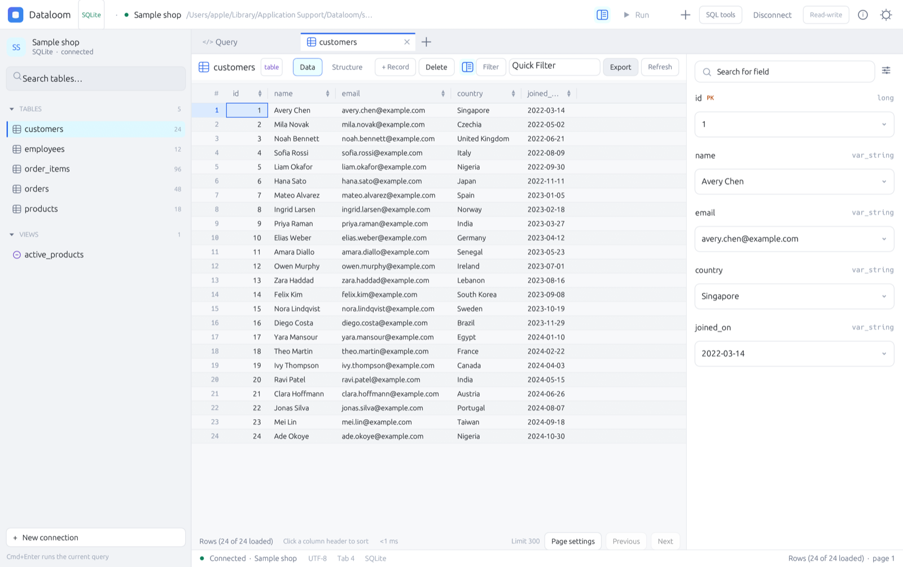
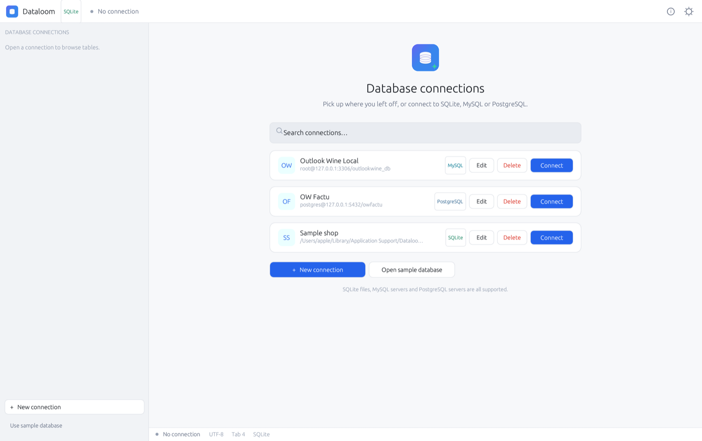
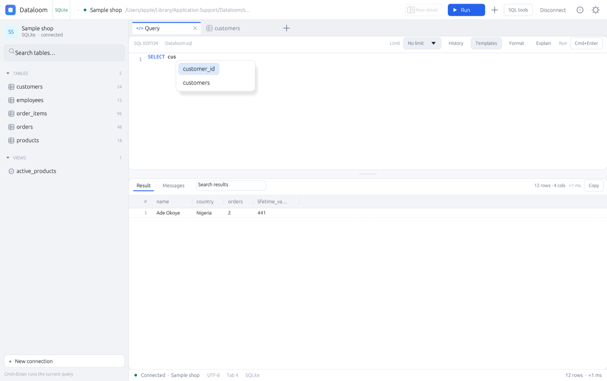
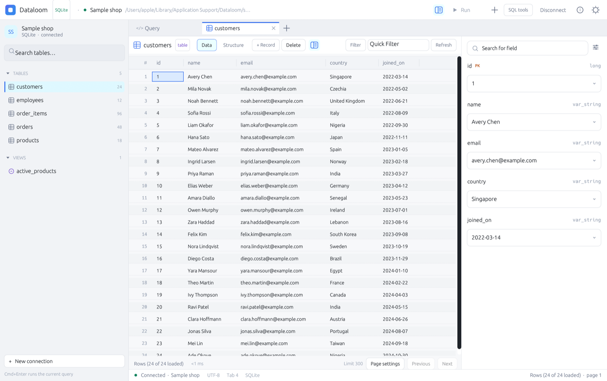

# Dataloom

**A native desktop SQL workspace for SQLite, MySQL and PostgreSQL — written in Rust with [`egui`](https://github.com/emilk/egui) / [`eframe`](https://github.com/emilk/egui/tree/master/crates/eframe).**

[](LICENSE)

Dataloom is a table-based database client for macOS. It keeps the loop that makes tools such as TablePlus pleasant to use — save connections, open a workspace, browse tables and views, run SQL, edit rows in a grid, move data in and out — without shipping a browser engine, and in a single native binary.

This is an independent reimplementation built from scratch. It is **not** affiliated with, endorsed by, or derived from the source code of TablePlus. Behaviour and measurements were reconstructed by inspecting the TablePlus 27.2 app bundle; the evidence is recorded in [`app/MECHANICS.md`](app/MECHANICS.md).



## Highlights

- **Three drivers** — SQLite files, MySQL and PostgreSQL servers, with connection groups, TLS modes and SSH tunnels.
- **A real SQL editor** — tabs, syntax highlighting, schema-aware autocomplete, formatting, snippets, named parameters, `EXPLAIN`, query history and cancellable background queries.
- **A fast data grid** — server-side paging and sorting, quick and per-column filters, virtualized rows, resizable columns and type-aware editors.
- **A row detail panel** — a searchable vertical editor for the selected record, with a calendar for dates, a JSON viewer and a blob inspector.
- **Data in and out** — CSV/Excel/SQL export, CSV/Excel/JSON import with column mapping, SQL dumps, and on-demand backups.
- **Workspace comfort** — session restore, command palette, light/dark themes, safe mode, read-only connections and editor transactions.

## Screenshots

| Connections | Query editor |
| --- | --- |
|  |  |

| Table browser | Row detail |
| --- | --- |
|  |  |

## Features

### Connections

- SQLite database files, chosen with a native file picker.
- MySQL and PostgreSQL connections with host, port, user, password and database fields.
- Saved connections can be grouped, searched, edited, duplicated and deleted.
- **Read-only** flag per connection, applied to the UI connection and every query worker; writes are refused, editing controls are disabled and a `read-only` chip is shown.
- **TLS** for network drivers: `Disable`, `Require`, `Verify CA` and `Verify full`, with an optional PEM/DER root certificate.
- **SSH tunnels** through the system `/usr/bin/ssh`, using `~/.ssh/config`, the SSH agent and an optional private key.
- Passwords are stored in the macOS Keychain (`com.dataloom.app`); they are never written to `connections.json` or included in exports.

### Query editor

- Any number of query tabs, each with its own SQL, row limit and editor/result split.
- Syntax highlighting, `⌘↩` to run, and a `Cancel` button while a statement is in flight.
- Work runs on a dedicated worker thread with its own connection, so a slow query never freezes the window; SQLite uses its interrupt handle, PostgreSQL its cancel token and MySQL a `KILL QUERY`.
- Schema-aware autocomplete (tables, views, cached columns and SQL keywords), with `↑`/`↓` to move and `Tab` to accept.
- SQL formatting, starter templates, named `:parameter` substitution and `EXPLAIN`.
- Query history persisted to disk, plus engine errors linked to the offending editor line.
- **Editor transactions**: Begin / Commit / Rollback apply to the query worker's connection and are shown in the query header.
- **Safe mode** asks for confirmation before running statements that modify the database.

### Table browser

- Sidebar tree of tables and views with row counts and name filtering.
- Server-side paging with a configurable limit and offset; the page step is `max(limit, 300)`.
- Quick Filter (case-insensitive contains) plus per-column filters combined with AND or OR; values are bound or escaped, never interpolated.
- Click a header to sort ascending, descending, then unsorted; `Shift`-click for multi-column sorts. Table tabs sort server-side, query results sort in memory.
- Virtualized grid: only visible rows are painted, so 100,000-row results stay responsive.
- Drag column separators to resize, double-click to auto-fit, or auto-fit all from the header menu.
- **Row detail** panel on demand (`Space`) for the selected record, following the cursor row.
- Type-aware editors: checkboxes for booleans, a calendar for dates, a formatted JSON window, dropdowns for MySQL/PostgreSQL enums and SQLite `CHECK ... IN (...)`, hex preview for blobs.
- Add and delete records, edit cells in place, copy a rectangular selection as TSV, and undo/redo cell edits.
- Views and tables without a key column remain read-only in place.

### Structure

- Columns, types, nullability, defaults, primary keys, indexes and the `CREATE` DDL for a table.
- Table operations: new table, clone, truncate and drop, with confirmations.
- PostgreSQL relations in other schemas are shown as `schema.table` and fully qualified everywhere.

### Import, export and backups

- Export the current table view as **CSV**, **Excel (`.xlsx`)** or **SQL**, including every row that matches the active filter — not just the visible page.
- Export a whole database to a `.sql` file (`CREATE` plus one `INSERT` per row) and import a `.sql` dump statement by statement.
- Import **CSV/TSV**, **JSON** and **Excel** (`.xlsx`, `.xls`, `.ods`) with a preview and column mapping; create a new table or append to an existing one. Imports run in a background thread inside a transaction and roll back completely on failure.
- Drop a file on the window to start an import.
- Timestamped, on-demand backups per connection: byte-for-byte copies for SQLite (restorable in place) and SQL dumps for MySQL/PostgreSQL.

### Workspace

- Tabbed workspace with query and table tabs, duplicate and close.
- Session restore: connection, open tabs, SQL, filters, sorts and scroll positions are saved every two seconds.
- Close confirmation when editor changes have not run.
- Command palette (`⇧⌘P`) that fuzzy-searches every command and its shortcut.
- Light and dark themes, adjustable data/SQL font sizes, row height, alternating rows, row numbers, tab width and default editor split.
- Native macOS menu bar, plus keyboard shortcuts that work without it.

## Requirements

- macOS 11 or newer (the primary and tested target).
- A recent stable Rust toolchain (edition 2021; tested with Rust 1.99).
- Xcode Command Line Tools for linking. `iconutil`, `sips` and `codesign` are only needed for `tools/package.sh`.

The UI is portable, but the native menu bar, Keychain integration and `.app` packaging are macOS-specific. Linux and Windows are not currently tested targets.

## Build and run

```bash
git clone https://github.com/roperto84/dataloom.git
cd dataloom/app

# Run from source
cargo run --release

# Run the unit tests
cargo test
```

On the first launch Dataloom creates a sample “Shop” SQLite database and seeds a connection for it, so there is something to browse immediately.

### Build a `.app` bundle

```bash
cd app
tools/package.sh             # build app/dist/Dataloom.app
tools/package.sh --install   # also copy it to /Applications
```

The script compiles a release binary, generates the `.icns` icon and writes an ad-hoc-signed app bundle.

## Where the data lives

Everything Dataloom owns lives in `~/Library/Application Support/Dataloom/`:

| Path | Contents |
| --- | --- |
| `connections.json` | Saved connections and groups (never passwords). |
| `settings.json` | Theme, fonts, row height, tab width, safe mode, session options. |
| `session.json` | The connection and tabs restored on the next launch. |
| `query_history.json` | Recent SQL statements. |
| `sample_shop.sqlite` | The sample database created on first launch. |
| `backups/<connection-id>/` | Timestamped backups for that connection. |

Deleting `connections.json` starts the app with an empty connection list (and re-seeds the sample only when the whole store is absent).

## Keyboard shortcuts

| Action | Shortcut |
| --- | --- |
| New connection | `⌘N` or `⌘K` |
| New query tab | `⌘T` |
| Close tab | `⌘W` |
| Duplicate tab | `⇧⌘T` |
| Run query | `⌘↩` |
| Run all queries | `⇧⌘↩` |
| Explain query | `⌘E` |
| Format SQL | `⇧⌘F` |
| Save | `⌘S` |
| Find | `⌘F` |
| Command palette | `⇧⌘P` |
| Settings | `⌘,` |
| Export SQL / Import SQL | `⇧⌘E` / `⇧⌘I` |
| Toggle read-only | `⇧⌘L` |
| Toggle theme | `⇧⌘D` |
| Toggle row detail (table tabs) | `Space` |
| Previous / next page | `⌘←` / `⌘→` |
| Undo / redo cell edit | `⌘Z` / `⇧⌘Z` |
| Zoom fonts | `⌘=` / `⌘-` / `⌘0` |
| Edit selected cell | `Enter` or `F2` |
| Copy selection | `⌘C` (TSV) |

Text fields keep their own undo history; `⌘Z` at the workspace level applies to cell and row-detail edits.

## Architecture

Dataloom is a single `eframe` application with no web view and no runtime service:

| Area | Location |
| --- | --- |
| App shell, chrome, tabs, sidebar, screenshot mode | [`app/src/app.rs`](app/src/app.rs) |
| Query editor, result pane, table browser, dialogs | [`app/src/views.rs`](app/src/views.rs) |
| Data grid, SQL highlighting, small painted controls | [`app/src/widgets.rs`](app/src/widgets.rs) |
| Drivers, paging, filtering, structure, sample data, table ops | [`app/src/db.rs`](app/src/db.rs) |
| CSV/JSON/Excel parsing and background import | [`app/src/import.rs`](app/src/import.rs) |
| Dependency-free XLSX writer | [`app/src/xlsx.rs`](app/src/xlsx.rs) |
| SSH local port forwarding | [`app/src/tunnel.rs`](app/src/tunnel.rs) |
| SQL formatting, parameters, errors, completion | [`app/src/sqlfmt.rs`](app/src/sqlfmt.rs) |
| Preferences and session | [`app/src/settings.rs`](app/src/settings.rs) |
| Commands, macOS menu bar, shortcut metadata | [`app/src/menu.rs`](app/src/menu.rs) |
| Light/dark palette and typography | [`app/src/theme.rs`](app/src/theme.rs) |

The UI keeps one connection; SQL execution uses a separate worker connection so results, transactions and cancellation belong to a stable tab id. Drivers sit behind the `Backend` enum in `db.rs`, so paging, filtering, structure and export share one code path per operation.

## Documentation

- [`app/MECHANICS.md`](app/MECHANICS.md) — the long mechanics sheet: what was measured, which values came from the original bundle, and which are recreation choices or estimates.
- [`app/mechanics.json`](app/mechanics.json) — the same values in machine-readable form.
- [`app/ROW_DETAIL_EVIDENCE.md`](app/ROW_DETAIL_EVIDENCE.md) — evidence behind the row detail panel.

## Known limitations

Dataloom is intentionally smaller than the original it takes cues from:

- No AI chat, metrics dashboards, MCP server, backup schedules or connection sync.
- SSH supports key/agent authentication only; password-only SSH cannot prompt because tunnels run with `BatchMode=yes`.
- No client certificates for TLS yet.
- Blobs are displayed and copied but not edited.
- Cell and row edits run outside the editor transaction and auto-commit.
- Query-result grids cannot open the row detail panel.
- Deleting a row asks for confirmation but has no undo history.
- CSV/Excel imports are held in memory; formulas are read from cached values only.
- SQL exports do not include `DROP TABLE IF EXISTS` and are not gzipped.
- Query history is one global file rather than per connection.
- The data grid header scrolls with the content; a sticky header is not implemented.

## Testing

```bash
cd app
cargo test
```

The suite covers paging validation, filter and `WHERE` construction, SQL splitting and formatting, type inference, CSV/JSON parsing, XLSX writing, SSH argument construction, theme constants and grid/keyboard helpers. It does not require a live database server or network access.

## Contributing

Issues and pull requests are welcome. Keep changes focused, run `cargo test`, and update `MECHANICS.md` when a documented behaviour or constant changes.

## Acknowledgements

Built with [`egui`/`eframe`](https://github.com/emilk/egui), [`rusqlite`](https://github.com/rusqlite/rusqlite), [`mysql`](https://github.com/blackbeam/rust-mysql-simple), [`postgres`](https://github.com/sfackler/rust-postgres), [`calamine`](https://github.com/tafia/calamine), [`rfd`](https://github.com/PolyMeilex/rfd) and [`muda`](https://github.com/tauri-apps/muda). TablePlus is a trademark of its respective owner and is referenced only as the inspiration for this independent project.

## License

Dataloom is released under the [MIT License](LICENSE).

Copyright © 2026 Roper.
